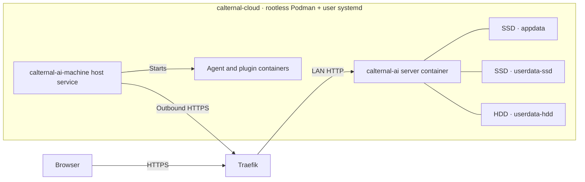

# Deploy Calternal-AI at calternal.cloud

Calternal-AI serves its web app and API at `https://calternal.cloud/`. Traefik
keeps its existing TLS configuration and sends HTTP to `10.70.3.162:8080`.
The host runs both roles as its lingering `calternal` user.



The image is built on x86_64 dev-01 using the repository's pinned Nix inputs and
Cargo/npm lockfiles. It contains a static Calternal binary, the web build,
trusted plugin manifests and digest-verified worker code, and an HTTP health
probe. The final image has no shell, Node runtime or package manager. The
web build's optional downloaded wallpaper assets depend on its cache and
availability at build time.

The machine runs the same static Calternal binary on the host. It starts
sandbox containers with Podman and provides only the assigned workspace and
provider home to an agent. The server's roots, the old app's files and the
Podman socket are outside those mounts. Putting the machine in a container
with the rootless user's Podman socket would give that container control
over the server's containers and bind mounts. The chosen host service keeps
that control with the operator's user account. Both roles share that Unix
account, so co-location depends on the container boundary and host trust.

On the 4-core, 8 GB host, the machine admits two sandbox slots **total** across
agent turns and plugin workers. Each agent sandbox has 1 CPU, 1 GiB memory and
256 PIDs. Each plugin worker has 1 CPU, 256 MiB memory and 64 PIDs, with
networking disabled. Operate the deployment with sandboxed machine mode.

## Choose the machine sandbox backend

Use `podman` on Linux machines without usable KVM and for the current provider
turn deployment. Rootless Podman puts each thread in its own container.
`auto` follows an account machine's server-stored execution setting and uses
Podman on pool machines. `direct` runs processes as the machine user with the
owner's consent and gives those processes the user's filesystem and network
access.

`microvm` is an opt-in Linux x86-64 pool backend for offline isolation testing.
It follows the [hybrid measurements](measurements/sandbox-hybrid.md) with
Firecracker and rootless Podman. Each account has its own booted kernel, a
private ext4 data disk and one container per thread. Spaces have separate homes
within that disk. The bundled guest has a single administrator-selected
container image. Change the pinned image as a unit with a machine-role restart.
The guest has a host-initiated vsock control channel and no NIC or host mounts.
Provider OAuth, package downloads and the command-line tool's remote operations
need a validated egress path. Account-wide provider credential sharing also
requires a credential-only path across space homes.

Run Firecracker as the machine user with read/write access to `/dev/kvm`.
An installer can grant access through the device's `kvm` group or a persistent
device ACL. Restart the role or open a fresh login after a group change. If the
device is missing or the KVM VM-creation ioctl fails after opening it, check
the host's KVM module and expose virtualization extensions to the machine VM on
the hypervisor. The offline guest needs no TAP, host `CAP_NET_ADMIN`, or root.
Firecracker bridges vsock to a Unix socket in the machine's private runtime
directory. A private boot device authenticates the host to the guest agent
before it decodes a control request. The guest supplies init, an unprivileged UID with guest-local
subuid/subgid ranges, and delegated cgroups for rootless Podman.

### Build and configure a disposable guest

Build the OCI archive on the development VM after `npm run build:plugins`.
Use a digest-qualified Node 24 Debian base. The archive must carry the exact
tag `localhost/calternal-standard:current` when loaded. Its content, the
static guest agent and CLI, the measured kernel and Nix-pinned runtime are
included in the resulting immutable image.

```sh
nix develop .#deploy -c cargo build --locked -j6 \
  --target x86_64-unknown-linux-musl -p calternal-machine -p calternal-server
podman build -f deploy/microvm/Containerfile --build-arg "BASE=$NODE_BASE_DIGEST" \
  -t localhost/calternal-standard:current .
podman save --format docker-archive -o standard.tar localhost/calternal-standard:current
nix develop .#microvm -c deploy/microvm/build-image.sh \
  target/x86_64-unknown-linux-musl/debug/calternal-microvm-agent \
  target/x86_64-unknown-linux-musl/debug/calternal standard.tar guest-image
nix develop .#microvm -c sh -c 'command -v firecracker mkfs.ext4'
```

Use one private machine directory per enrolled identity. Put the machine-wide
settings in an operator-owned JSON file. Replace the three absolute paths
with the Nix store paths and `image_digest` with the SHA-256 value printed by
the image build. Keep the store artifact rooted and immutable for the duration
of the machine role.

```json
{
  "firecracker": "/absolute/path/to/firecracker",
  "mkfs_ext4": "/absolute/path/to/mkfs.ext4",
  "image_directory": "/absolute/path/to/guest-image",
  "image_digest": "sha256-of-the-image.sha256-manifest",
  "vcpus": 2,
  "memory_mib": 1024,
  "disk_mib": 4096,
  "max_guests": 4,
  "warm_guests": 1
}
```

```sh
calternal machine run --backend microvm --dir "$MACHINE_DIR" \
  --microvm-config "$MICROVM_CONFIG"
```

The role verifies the kernel and system disk once at startup. It keeps up to
two prebooted guests with blank account data, within the configured VMM cap.
A new account can take one of them. An existing account cold boots from its
own disk. After the last container lease releases its guest reference, a sweep
can stop the guest after ten idle minutes, with a 15-second sweep interval.
CPU and RAM are configured per guest. The writable disk is sparse and capped
by its logical size at creation. Reserve host disk capacity for all retained
account disks. Changing disk size affects new disks. The plan decision bills elapsed sandbox running time. Monthly accounting
and plan-selected sizes are separate from these operator settings.

A role restart stops or fences old VMMs before clearing their transient files.
A guest failure interrupts its active turns, which can resume from their
checkpoint. A durable account erasure stops the guest and unlinks its disk
before the machine acknowledges it. Thread erasure removes only the workspace
and flushes the guest disk before acknowledgement. Account disks persist through
normal idle stops and restarts. Treat any backups of these disks as private
account data. Use a fresh enrollment for the offline preview to avoid splitting
one machine identity's storage across backend types.

## Deploy and roll back

From the dev-01 build checkout run `deploy/deploy.sh --target deploy/cloud.conf`.
It builds and sends the image via SSH, stages the units and matching machine
binary, stops both services, and promotes the image to `:current`. It verifies
HTTP readiness on the published address and runs the container probe. If
the new release fails those checks, it restarts the previous release. A
successful deploy retains one previous release under `:rollback`.
`deploy/rollback.sh --target deploy/cloud.conf` swaps the releases and checks
health. Add `--dry-run` to see the SSH calls before running either script.

Deploy and rollback reuse the three data roots. A schema mismatch can refuse
startup, including when an older binary opens data initialized by a newer one.
Per-space stores that open lazily may first report a mismatch when used.
Automatic rollback switches code and units. Recovering data requires a
coordinated backup and an operator decision. See **Decisions before real data**
below.

## Backups and service controls

Keep the installation UUID in `/srv/calternal-ai/server.env` with the backups.
The SSD VM backup should cover `/srv/calternal-ai/appdata`,
`/srv/calternal-ai/userdata-ssd`, the unit and configuration files, and
`/srv/calternal-ai/machine`. This includes private credentials and provider homes.
Verify that the VM backup also captures the separate disk mounted at `/mnt/hdd`
and its `calternal-ai/userdata-hdd` tree. Schedule a separate backup if the HDD is
outside the VM backup. For a coordinated pre-deploy restore point, stop both
roles before taking the snapshot. Keep the old app's backup policy in force.

Run on the host as `calternal` to inspect or stop the service:

```sh
systemctl --user status calternal-ai.service calternal-ai-machine.service
journalctl --user -u calternal-ai.service -u calternal-ai-machine.service -f
podman healthcheck run calternal-ai
systemctl --user stop calternal-ai-machine.service calternal-ai.service
systemctl --user start calternal-ai.service calternal-ai-machine.service
```

A manual stop lasts until the next start or boot. To stop across boots, disable
the machine service and move the server's `.container` file out of the Quadlet
search path, then run `systemctl --user daemon-reload`.

## Cut over from the existing app

**Device sync pauses at cutover.** The existing container's calternaldav
listener on port 993 stops with it. Calternal-AI has no DAV bridge and publishes
only the web port. The owner's phone and Mac will stop syncing CardDAV contacts
and CalDAV reminders and calendars with `calternal.cloud` until that plugin is
available here. Restoring the old container restores its DAV listener.

1. Record the Traefik **source** address observed by the backend. Keep the
   public Host header intact, have Traefik replace untrusted forwarding
   headers, and restrict access to the LAN port to Traefik using the host's
   existing network policy. Confirm rootless Podman with cgroup v2 and pasta.
   If you need to identify the source IP, watch the connection metadata on the
   target while requesting the old app's `/healthz` through its public URL.
   As the administrator, provision the mount points:

   ```sh
   # Optional source-IP check while another terminal requests /healthz.
   tcpdump -ni any -c 5 'tcp dst host 10.70.3.162 and dst port 8080'
   loginctl show-user calternal -p Linger
   test "$(uname -m)" = x86_64
   mountpoint -q /mnt/hdd
   install -d -m 0700 -o calternal -g calternal /srv/calternal-ai /mnt/hdd/calternal-ai
   ```

2. On the target as `calternal`, create the public configuration once. Replace
   `TRAEFIK_IP` with the recorded IPv4 address. Its `/32` is the only trusted
   forwarding peer. The origin supplies the relying-party ID
   `calternal.cloud`.

   ```sh
   umask 077
   TRAEFIK_IP=REPLACE_WITH_TRAEFIK_SOURCE_IPV4
   (
     set -C
     printf 'CALTERNAL_INSTALLATION_ID=%s\nCALTERNAL_ORIGIN=https://calternal.cloud\nCALTERNAL_TRUSTED_PROXIES=%s/32\n' \
       "$(cat /proc/sys/kernel/random/uuid)" "$TRAEFIK_IP" > /srv/calternal-ai/server.env
   )
   test "$(stat -Lc %a "$HOME/calternal-secrets.env")" = 600
   podman info --format '{{.Host.CgroupsVersion}} {{.Host.RootlessNetworkCmd}}'
   podman pull docker.io/library/node:24-alpine
   ```

3. On the dev-01 build host, stage the server and machine sandbox images
   before taking the old app down. Set `CALTERNAL_DEPLOY_HOST` to the
   coordinator's authorized SSH endpoint if it differs from the default.
   Build as a non-root operator with access to the dev host's Podman.

   ```sh
   export CALTERNAL_DEPLOY_HOST=calternal@calternal-cloud
   revision=$(git rev-parse --short=12 HEAD)
   export RELEASE_REVISION=$(git rev-parse HEAD)
   export SOURCE_DATE_EPOCH=$(git show -s --format=%ct HEAD)
   nix develop .#deploy -c deploy/build-image.sh "localhost/calternal-ai:$revision"
   deploy/build-provider.sh localhost/calternal-ai-claude:current
   podman save localhost/calternal-ai-claude:current | ssh "$CALTERNAL_DEPLOY_HOST" podman load --quiet
   deploy/deploy.sh --target deploy/cloud.conf --image "$revision" --initialize --dry-run
   ```

4. On the target as `calternal`, stop and disable the old generated service
   by retaining its Quadlet under a disabled filename. Keep
   `/srv/calternal-app/data` intact. Then run the deploy command from dev-01.

   ```sh
   systemctl --user stop calternal.service
   mv "$HOME/.config/containers/systemd/calternal.container" \
      "$HOME/.config/containers/systemd/calternal.container.cutover-disabled"
   systemctl --user daemon-reload
   ```

   ```sh
   deploy/deploy.sh --target deploy/cloud.conf --image "$revision" --initialize
   curl -fsS https://calternal.cloud/api/v1/auth/status
   curl -fsS -o /dev/null https://calternal.cloud/
   ```

5. Open `https://calternal.cloud/` and register the first owner with the
   target's mode-0600 `/srv/calternal-ai/appdata/setup.token`. Read it only from
   a private session on the target. Get the new account UUID from the
   signed-in `/api/v1/auth/me` response (`user.id`). Run the operator CLI flow
   as `calternal`. Every instance needs an enrolled sandboxing machine.
   Sign in to the provider inside the enrolled account's sandbox home,
   then run a smoke turn before signing off the cutover.

   ```bash
   set -o pipefail
   read -r -p 'New owner account UUID: ' account
   podman exec calternal-ai /usr/local/bin/calternal --json machines code \
     --account "$account" --appdata /data/appdata --userdata-ssd /data/userdata-ssd \
     --userdata-hdd /data/userdata-hdd |
     jq -er .data.code |
     /srv/calternal-ai/releases/current/calternal machine enroll \
       --server https://calternal.cloud --dir /srv/calternal-ai/machine --name calternal-cloud --code -
   systemctl --user start calternal-ai-machine.service
   /srv/calternal-ai/releases/current/calternal machine status --dir /srv/calternal-ai/machine
   account=$(/srv/calternal-ai/releases/current/calternal --json machine status \
     --dir /srv/calternal-ai/machine | jq -er '.data.owner | sub("^account:"; "")')
   provider_home=/srv/calternal-ai/machine/sandboxes/accounts/$account/home
   install -d -m 0700 "$provider_home"
   podman run --rm -it --env HOME=/home/agent --volume "$provider_home:/home/agent" \
     localhost/calternal-ai-claude:current claude auth login
   ```

6. To undo the cutover, on the target as `calternal`, stop the new roles
   and restore the old Quadlet on the same port. Confirm the old app through
   Traefik. Keep the new roots for recovery and diagnosis.

   ```sh
   units=$HOME/.config/containers/systemd
   if systemctl --user cat calternal-ai.service >/dev/null 2>&1; then
     systemctl --user stop calternal-ai-machine.service calternal-ai.service
     systemctl --user disable calternal-ai-machine.service
     mv "$units/calternal-ai.container" "$units/calternal-ai.container.cutover-disabled"
   fi
   mv "$units/calternal.container.cutover-disabled" "$units/calternal.container"
   systemctl --user daemon-reload
   systemctl --user start calternal.service
   curl -fsS https://calternal.cloud/healthz
   ss -ltn 'sport = :993'
   ```

## Decisions before real data

- **Schema transitions.** Choose a maintenance-window export and import
  with a rehearsed restore, or keep this release family on one schema until
  a supported transition is agreed. Export and import require tooling and
  downtime. Keeping the schema stable limits which releases can ship.
- **Existing app data.** Choose whether it stays in its separately retained
  installation or needs an explicit import project. An import requires a
  mapping and validation of accounts, files and permissions.
- **Backups.** Confirm HDD coverage and select a retention and restore policy
  for the SSD, HDD and sensitive machine state. Retaining more coordinated
  restore points uses more storage.
