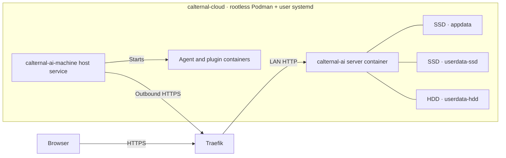

# Deploy Calternal-AI at calternal.cloud

Calternal-AI serves its web app and API at `https://calternal.cloud/`. Traefik
keeps its existing TLS configuration and sends HTTP to `10.70.3.162:8080`.
The host runs both roles as its lingering `calternal` user.



The image is built on x86_64 dev-01 using the repository's pinned Nix inputs and
Cargo/npm lockfiles. It contains a static Calternal binary, the web build,
trusted plugin manifests and digest-verified worker code, and an HTTP health
probe. The final image has no shell, Node runtime or package manager. The
web build's optional downloaded wallpaper assets depend on its cache and
availability at build time.

The packaged `trusted-plugins.json` drives the first installation's plugin
catalog. Subsequent starts load the approved package archives from appdata.
Install additional provider manifests through the same package review and
installation flow used for other plugins.
Development servers can use the source checkout's trusted catalog with a
separate directory of replacement packages.

The machine runs the same static Calternal binary on the host. It starts
sandbox containers with Podman and provides only the assigned workspace and
provider home to an agent. The server's roots, the old app's files and the
Podman socket are outside those mounts. Putting the machine in a container
with the rootless user's Podman socket would give that container control
over the server's containers and bind mounts. The chosen host service keeps
that control with the operator's user account. Both roles share that Unix
account, so co-location depends on the container boundary and host trust.

On the 4-core, 8 GB host, the machine admits two sandbox slots **total** across
agent turns and plugin workers. Each agent sandbox has 1 CPU, 1 GiB memory and
256 PIDs. Each plugin worker has 1 CPU, 256 MiB memory and 64 PIDs, with
networking disabled. Operate the deployment with sandboxed machine mode.

### Route the co-located machine through Traefik

Run the following checks on the deployment host as `calternal`. The
`-v` output shows whether the TCP connection opens before TLS starts. If
the host reaches other public addresses but gets no TCP answer from its own
public address, and the second request succeeds, the route has a hairpin
failure. Use the verified internal Traefik address in the target file. The
production VM's Proxmox SDN path supports 1,450-byte packets. The observed
timeout occurs at TCP connect, before TLS or HTTP exchanges begin.

```sh
curl -fv --noproxy '*' --connect-timeout 5 --max-time 8 https://calternal.cloud/api/v1/auth/status
curl -fv --noproxy '*' --connect-timeout 5 --max-time 8 \
  --resolve calternal.cloud:443:10.70.3.101 https://calternal.cloud/api/v1/auth/status
```

`deploy/cloud.conf` sets `MACHINE_CONNECT=calternal.cloud:443=10.70.3.101`.
Deploy passes it as `--connect-address HOST:PORT=IP` to the machine unit.
The public URL, HTTP Host header, TLS server name and certificate checks use
`calternal.cloud`. Leave the setting empty on targets that can reach their
configured origin normally. A separately managed machine can pass the same
flag to both `calternal machine enroll` and `calternal machine run`. Keep
the override in its service command so reconnects use the same route.

Deploy and rollback wait for the machine to open an authenticated session.
On a fresh installation the readiness condition is a reachable server
reporting that first-owner setup is needed, with the machine waiting for its
handoff. A machine readiness failure fails deployment even if the web
health probe passed. On failure, deploy and rollback try the public origin
from the host and name `MACHINE_CONNECT` if TCP cannot connect. Inspect
`journalctl --user -u calternal-ai-machine.service` on the target for the
machine's connection failure.

## Route public shares

Keep `/s/` on the same Traefik HTTPS route as the app. Preserve the Host
header and path, including member addresses and the query string. Disable
edge caching and exclude the bearer path from access logs and request traces.
The backend serves the guest document directly and responds to requests with
`Accept: application/json` on the same address. Verify a disposable link with
both representations and HEAD. Revoke it and repeat the requests. Each should
then return 404.

## Enable account email

Run these steps as the deployment's `calternal` user. Use the SMTP
provider's host, port, TLS mode, login and verified sender. Calternal
supports implicit TLS (`implicit`, usually port 465) and required
STARTTLS (`starttls`, usually port 587). A server without SMTP can use
passkeys, recovery codes and operator recovery with email optional.

Enter the SMTP password at the hidden prompt. The shell pipeline
below hands it to the rootless Podman secret store over standard input.
The credential stays out of the repository, deployment environment
files, command arguments and logs.

```bash
(
  set +x
  IFS= read -r -s -p 'SMTP password: ' smtp_password || exit 1
  printf '\n' >&2
  test -n "$smtp_password" || exit 1
  printf '%s' "$smtp_password" | podman secret create --replace calternal-ai-smtp-password -
)
```

Create
`~/.config/containers/systemd/calternal-ai.container.d/90-account-mail.conf`
with the following lines, substituting your provider's settings. Quadlet
injects the password as the server container's `CALTERNAL_SMTP_PASSWORD`
at runtime. Each server instance needs its own drop-in and secret name.

```ini
[Container]
Environment=CALTERNAL_SMTP_HOST=smtp.example.org
Environment=CALTERNAL_SMTP_PORT=587
Environment=CALTERNAL_SMTP_TLS=starttls
Environment=CALTERNAL_SMTP_USERNAME=calternal
Environment=CALTERNAL_SMTP_FROM=security@example.org
Secret=calternal-ai-smtp-password,type=env,target=CALTERNAL_SMTP_PASSWORD
```

```sh
systemctl --user daemon-reload
systemctl --user restart calternal-ai.service
podman exec calternal-ai /usr/local/bin/calternal mail-test you@example.org --appdata /data/appdata
```

The command reports SMTP acceptance. Check the mailbox for the message
before enabling the hosted email requirement. To enable it, add
`Environment=CALTERNAL_ACCOUNT_EMAIL_REQUIRED=1` to the same `[Container]`
section and reload and restart again. Existing accounts can sign in and are
asked to provide and verify an address. Remove the drop-in to return to
optional email with no SMTP. When rotating the secret, restart the unit
to recreate the container with the new value.

[Podman secret provisioning](https://docs.podman.io/en/latest/markdown/podman-secret-create.1.html)
· [Quadlet configuration](https://docs.podman.io/en/latest/markdown/podman-systemd.unit.5.html)

## Choose the machine sandbox backend

Use `podman` on Linux machines without usable KVM and for the current provider
turn deployment. Rootless Podman puts each thread in its own container.
`auto` follows an account machine's server-stored execution setting and uses
Podman on pool machines. `direct` runs processes as the machine user with the
owner's consent and gives those processes the user's filesystem and network
access.

`microvm` is an opt-in Linux x86-64 pool backend for isolation testing.
It follows the [hybrid measurements](measurements/sandbox-hybrid.md) with
Firecracker and rootless Podman. Each account has its own booted kernel, a
private ext4 data disk and one container per thread. Spaces have separate homes
within that disk. Claude uses the account-wide login directory from the
Podman backend. Turns mount it read-only and login runs use a disposable
home with a writable mount. The guest uses one administrator-selected
container image. The immutable guest root holds the unpacked OCI filesystem.
Podman gives each thread a writable overlay on the account disk. Boot reads
the shared lower layer and skips per-account image import. Change the pinned
image as a unit with a machine-role restart. Keep one active image and at most
one rollback image rooted per machine. Drop older deployment roots so the
operator’s normal Nix garbage collection can reclaim them.
The guest uses vsock for control and has no host filesystem mounts. It
boots offline unless the operator installs a TAP egress policy.

Run Firecracker as the machine user with read/write access to `/dev/kvm`.
An installer can grant access through the device's `kvm` group or a persistent
device ACL. Restart the role or open a fresh login after a group change. If the
role cannot open the device, read KVM API version 12, and create a VM with
the machine user’s permissions, it logs the reason and uses rootless Podman.
Machine readiness reports `sandbox_fallback: "kvm_unavailable"`; the
fallback has the container isolation boundary. A missing Podman installation
returns an explicit startup error. For Proxmox, the hypervisor operator
checks nested KVM on the physical host and exposes virtualization extensions
to the machine VM, then reruns the machine role probe in a fresh guest login. The offline guest needs no TAP, host `CAP_NET_ADMIN`, or root.
Firecracker bridges vsock to a Unix socket in the machine's private runtime
directory. A private boot device authenticates the host to the guest agent
before it decodes a control request. The guest supplies init, an unprivileged UID with guest-local
subuid/subgid ranges, and delegated cgroups for rootless Podman.

### Install guest egress

Use a dedicated, operator-managed Linux network namespace for the networked
machine role. The namespace needs an uplink that can reach the app server for
the role's own control plane traffic. The operator enables IPv4 forwarding
there and creates each persistent TAP for the machine UID, with one routed
subnet per TAP. For each entry in [the policy example](../deploy/microvm/egress.example.json),
use `ip tuntap add dev TAP mode tap user MACHINE_UID`, assign the entry's
`gateway/prefix` to that device with `ip addr add`, and bring the link up.
Run these operations inside the declared namespace.

Keep one root-owned, readable policy JSON file for the role. Name a TAP slot
for each configured guest slot. List approved IPv4 destinations as explicit
CIDRs, TCP or UDP, and ports. Each slot declares its approved public DNS
resolver. The allowlist starts empty. List public control-plane and other
operator-managed service ranges in `deny` before adding any allowed ranges. The host firewall drops incoming guest
connections, traffic between guests, host-local access, private destinations
and metadata traffic. It permits replies to authorized egress and NATs approved
traffic on the uplink.

List the approved addresses for these HTTPS endpoints on TCP 443:

| Workload | Endpoints |
| --- | --- |
| Direct Claude Code turns | `api.anthropic.com`. |
| Claude subscription sign-in and refresh | `platform.claude.com` for OAuth token exchange and refresh. The browser performing sign-in also needs `claude.com` and `claude.ai`, plus `sso.claude.com` where the organization uses SSO. Apply the browser requirements wherever the browser runs. |
| npm package installs | `registry.npmjs.org` or the configured registry or mirror. Include approved tarball hosts, Git sources, or binary download hosts required by the project's lockfile and install scripts. |
| Python installs from public PyPI | `pypi.org` for the index and `files.pythonhosted.org` for distributions. |
| Rust installs from the public sparse registry | `index.crates.io` for the index and `static.crates.io` for crates. |

For other package managers, list the approved index and artifact download
hosts for the registries the project uses. The guest image already includes
the pinned Claude Code binary. Add endpoints for optional Claude Code
features only when the operator enables those features.
[Claude Code network requirements](https://code.claude.com/docs/en/network-config#network-access-requirements)
[npm registry documentation](https://docs.npmjs.com/cli/v11/using-npm/registry/)
[PyPI index API](https://docs.pypi.org/api/index-api/)
[Cargo registry configuration](https://index.crates.io/config.json)

Resolve approved hostnames using the configured guest resolver and record the
reviewed IPv4 addresses or published destination CIDRs in `allow`. The firewall
matches IPs and ports. Refresh the same JSON file when DNS answers, provider
ranges, registry configuration, or package download sources change. Remove
superseded entries and retain the explicit `deny` ranges.

With the role stopped, run `deploy/microvm/install-egress.py POLICY.json`
as the namespace operator. It installs the firewall transaction and writes
a bounded receipt beside the policy. Use the same stop, install, and restart
sequence after each update. Set `network_policy` in the machine config to the
absolute JSON path and run the unprivileged machine role in the same
namespace. The role verifies that the receipt matches the policy, namespace
and current host boot before opening a TAP. Missing or mismatched files
prevent networked startup. After restart, verify a disposable Claude turn and
a package download through the updated policy. Guests run without a NIC
when the setting is omitted. A KVM fallback uses network-disabled Podman
containers.

To roll back, stop the machine role, remove its policy receipt, and remove
`network_policy` before restarting offline. Remove the dedicated namespace
only after the role has stopped. Retain the current policy and receipt only.

### Build and configure a disposable guest

Build the OCI archive on the development VM after `npm run build:plugins`.
Use a digest-qualified Node 24 Debian base. The archive carries one image. Its filesystem, the
static guest agent and CLI, the measured kernel and Nix-pinned runtime are
included in the resulting immutable image.

```sh
nix develop .#deploy -c cargo build --locked -j6 \
  --target x86_64-unknown-linux-musl -p calternal-machine -p calternal-server
podman build -f deploy/microvm/Containerfile --build-arg "BASE=$NODE_BASE_DIGEST" \
  -t localhost/calternal-standard:current .
podman save --format docker-archive -o standard.tar localhost/calternal-standard:current
nix develop .#microvm -c deploy/microvm/build-image.sh \
  target/x86_64-unknown-linux-musl/debug/calternal-microvm-agent \
  target/x86_64-unknown-linux-musl/debug/calternal standard.tar guest-image
nix develop .#microvm --profile "$PWD/guest-runtime" \
  -c sh -c 'command -v firecracker mkfs.ext4'
```

Use one private machine directory per enrolled identity. Put the machine-wide
settings in an operator-owned JSON file. Use the executable paths printed
by the runtime shell and the absolute guest image path. Set `image_digest`
to the SHA-256 value printed by the image build. Keep the runtime profile
and image rooted for the lifetime of the machine role so Nix garbage
collection leaves their store paths available.

```json
{
  "firecracker": "/absolute/path/to/firecracker",
  "mkfs_ext4": "/absolute/path/to/mkfs.ext4",
  "image_directory": "/absolute/path/to/guest-image",
  "image_digest": "sha256-of-the-image.sha256-manifest",
  "vcpus": 2,
  "memory_mib": 512,
  "disk_mib": 4096,
  "max_guests": 4,
  "warm_guests": 1
}
```

```sh
calternal machine run --backend microvm --dir "$MACHINE_DIR" \
  --microvm-config "$MICROVM_CONFIG"
```

The 512 MiB and 1,024 MiB profiles each have two active thread slots across
the person's pool work. A third turn shows **Waiting for capacity** with its queue position.
The person can cancel while waiting. Placement retries when an active slot
is released. Three threads at 1,024 MiB were at the median-latency cutoff
on the busy development host. Both profiles stay within the machine-wide
sandbox ceiling.

The role verifies the kernel and system disk once at startup. It keeps up to
two prebooted guests with blank account data, within the configured VMM cap.
A new account can take one of them. An existing account cold boots from its
own disk. After the last container lease releases its guest reference, a sweep
can stop the guest after ten idle minutes, with a 15-second sweep interval.
The 512 MiB performance budget for resuming a stopped guest is about one
second, p90 under 1.1 s, through completion of the first command.
CPU and RAM are configured per guest. The writable disk is sparse and capped
by its logical size at creation. Reserve host disk capacity for all retained
account disks. Changing disk size affects new disks. The plan decision bills elapsed sandbox running time. Monthly accounting
and plan-selected sizes are separate from these operator settings.

A role restart stops or fences old VMMs before clearing their transient files.
A guest failure interrupts its active turns, which can resume from their
checkpoint. A durable account erasure stops the guest and unlinks its disk
before the machine acknowledges it. Thread erasure removes only the workspace
and flushes the guest disk before acknowledgement. Account disks persist through
normal idle stops and restarts. Treat any backups of these disks as private
account data. Use a fresh enrollment for the preview to avoid splitting
one machine identity's storage across backend types.

## Deploy and roll back

From the dev-01 build checkout run `deploy/deploy.sh --target deploy/cloud.conf`.
It builds and sends the image via SSH, stages the units and matching machine
binary, stops both services, and promotes the image to `:current`. It verifies
HTTP readiness on the published address, runs the container probe and
waits for machine readiness. If the new release fails those checks, it restarts the previous release. A
successful deploy retains one previous release under `:rollback`.
`deploy/rollback.sh --target deploy/cloud.conf` swaps the releases and checks
health. Add `--dry-run` to see the SSH calls before running either script.

Provider sign-in needs a matching Claude sandbox image. Build the plugins and
run `deploy/build-provider.sh` on the build VM from the same revision as the
server and machine binary. Stage the rebuilt sandbox image on the target before
activating the release. The account's login stays on the machine under
`sandboxes/accounts/<account>/provider-login`, and its transcript home is
scoped to the space.

The production upgrade gate and durable inventory are tracked in
[Data-preserving upgrades](upgrades.md).

From the durable baseline, ordinary updates require `--compatibility-proof FILE`
from `scripts/verify-additive-upgrade.sh PREVIOUS_IMAGE CANDIDATE_IMAGE PROOF_OUTPUT`
for the exact current and candidate images. Use `--allow-incompatible` only with the owner's approval. The latter stages a full
restore point before changing data. An incomplete preparation fences server
startup. A deployment retry, rollback, or the server unit's recovery hook can
restore the staged bytes before either release starts. After the cutover marker,
rollback keeps live data and the older build must pass its version check.

### Supervised update from production revision `4735733eeb09`

The release-pair proof to `86306143` refused rollback on `jobs.db` version
3. Take the supervised path below for an update from `4735733eeb09`.
The selected candidate must be a gated `dev` commit with the v2 restore
point and its matching deployment scripts. `86306143` itself has v1.

Approve and run each numbered step before proceeding. Use a private Bash
session on dev-01 for steps 1–3 and 6, and a separate private Bash session
as `calternal` on the target for steps 4–5. Use the same shells for checks
and recovery. Keep shell tracing disabled. Before starting, identify an
already-mounted encrypted backup directory on separate storage. Keep
Traefik and the existing provider sandbox image in place.

1. **Pin the gated candidate.** Start in its clean dev-01 checkout.
   Enter the full commit from the coordinator's latest passing gate.
   Check that this commit contains both the restore-point implementation
   and the read-only account-count command used below.

   ```bash
   set -euo pipefail
   umask 077
   read -r -p 'Full gated dev commit: ' gated
   [[ $gated =~ ^[a-f0-9]{40}$ ]]
   git fetch origin dev
   git merge-base --is-ancestor "$gated" origin/dev
   test "$(git rev-parse HEAD)" = "$gated"
   test -z "$(git status --porcelain)"
   git grep -q -F calternal-upgrade-intent/v2 "$gated" -- crates/server/src/upgrades
   git grep -q -w AccountCount "$gated" -- crates/server/src/upgrade_cli.rs
   export CALTERNAL_DEPLOY_HOST=calternal@calternal-cloud
   export RELEASE_REVISION=$gated
   export SOURCE_DATE_EPOCH=$(git show -s --format=%ct "$gated")
   revision=$(git rev-parse --short=12 "$gated")
   candidate=localhost/calternal-ai:$revision
   ```

2. **Confirm the outgoing release.** Require the running container and
   its current image tag to agree, then check the full revision.

   ```bash
   previous=$(ssh -o BatchMode=yes "$CALTERNAL_DEPLOY_HOST" \
     podman container inspect --format '{{.Image}}' calternal-ai)
   current=$(ssh -o BatchMode=yes "$CALTERNAL_DEPLOY_HOST" \
     podman image inspect --format '{{.Id}}' localhost/calternal-ai:current)
   previous=${previous#sha256:}
   [[ $previous =~ ^[a-f0-9]{64}$ ]]
   test "$previous" = "${current#sha256:}"
   observed=$(ssh -o BatchMode=yes "$CALTERNAL_DEPLOY_HOST" \
     "podman image inspect --format '{{ index .Labels \"org.opencontainers.image.revision\" }}' $previous")
   test "$observed" = 4735733eeb09f084aeac8ac28cb9bd668ed4b760
   ```

3. **Build, stage and preview.** Check free space and memory before starting
   the release build on dev-01. Stop below 15 GB disk or 8 GB available
   memory. Copy both printed image IDs to the target shell in step 4.

   ```bash
   df -h ~
   free -h
   release_target=$(mktemp -d)
   flock -o -w 14400 /tmp/calternal-gate-2.lock bash -c '
     set -euo pipefail
     export CARGO_TARGET_DIR="$2"
     trap "find \"\$CARGO_TARGET_DIR\" -depth -delete" EXIT
     nix develop .#deploy -c deploy/build-image.sh "$1"
   ' -- "$candidate" "$release_target"
   candidate_id=$(podman image inspect --format '{{.Id}}' "$candidate")
   candidate_id=${candidate_id#sha256:}
   test "$candidate_id" != "$previous"
   podman save "$candidate" | ssh -o BatchMode=yes "$CALTERNAL_DEPLOY_HOST" podman load --quiet
   deploy/deploy.sh --target deploy/cloud.conf --image "$revision" --allow-incompatible --dry-run
   printf 'Previous image: %s\nCandidate image: %s\n' "$previous" "$candidate_id"
   ```

4. **Preflight before stopping.** On the target, extract the executable
   from the exact staged image. This probe checks the live footprint and
   does not change the data. Retain the private work directory through
   activation and recovery.

   ```bash
   set -euo pipefail
   umask 077
   read -r -p 'Previous image ID: ' previous
   read -r -p 'Candidate image ID: ' candidate_id
   [[ $previous =~ ^[a-f0-9]{64}$ && $candidate_id =~ ^[a-f0-9]{64}$ ]]
   observed=$(podman container inspect --format '{{.Image}}' calternal-ai)
   test "${observed#sha256:}" = "$previous"
   podman image exists "$candidate_id"
   root=/srv/calternal-ai
   hdd=/mnt/hdd/calternal-ai/userdata-hdd
   mountpoint -q /mnt/hdd
   ops=$(mktemp -d "$HOME/calternal-ai-cutover.XXXXXXXX")
   (
     extraction=$(podman create --network none "$candidate_id")
     trap 'podman rm --ignore "$extraction" >/dev/null' EXIT
     podman cp "$extraction:/usr/local/bin/calternal" "$ops/calternal"
   )
   chmod 0700 "$ops/calternal"
   installation=$(sed -n 's/^CALTERNAL_INSTALLATION_ID=//p' "$root/server.env")
   up=("$ops/calternal" --json upgrade --appdata "$root/appdata"
       --userdata-ssd "$root/userdata-ssd" --userdata-hdd "$hdd"
       --installation-id "$installation" --machine-dir "$root/machine")
   "${up[@]}" preflight --previous "$previous" --candidate "$candidate_id" --incompatible
   ```

5. **Stop, back up and verify.** Stop both roles for the coordinated
   backup. Keep them stopped until the chosen deployment command.
   Enter the already-mounted private encrypted backup directory. The
   backup holds credentials. Treat its archive and verification log as
   private. This step serves both deployment paths.

   ```bash
   systemctl --user stop calternal-ai-machine.service calternal-ai.service
   stopped=0
   podman container exists calternal-ai || stopped=$?
   test "$stopped" -eq 1
   read -r -p 'Mounted encrypted backup directory: ' backup_dir
   [[ $backup_dir = /* && -d $backup_dir && -w $backup_dir ]]
   mountpoint -q -- "$backup_dir"
   backup=$(mktemp "$backup_dir/calternal-ai-state.XXXXXXXX.tar")
   previous_oci=$(mktemp "$backup_dir/calternal-ai-image.XXXXXXXX.oci")
   members=(srv/calternal-ai mnt/hdd/calternal-ai/userdata-hdd
     "${HOME#/}/.config/containers/systemd/calternal-ai.container"
     "${HOME#/}/.config/systemd/user/calternal-ai-machine.service"
     "${HOME#/}/calternal-secrets.env")
   tar --acls --xattrs --numeric-owner -C / -cpf "$backup" "${members[@]}" 2>"$ops/backup.log"
   tar -tf "$backup" >/dev/null
   tar --acls --xattrs --numeric-owner -C / --compare -f "$backup" >>"$ops/backup.log" 2>&1
   podman save --format oci-archive "$previous" >"$previous_oci"
   tar -tf "$previous_oci" >/dev/null
   sha256sum -- "$backup" "$previous_oci" >"$ops/sha256"
   sha256sum -c --status "$ops/sha256"
   printf 'Verified backup: %s\nImage archive: %s\nVerification record: %s\n' "$backup" "$previous_oci" "$ops/sha256"
   ```

6. **Authorize and launch the incompatible handoff.** Confirm the backup
   result and record the owner's approval for these image IDs. Run this
   command on dev-01. The driver rereads the preflight under the locks,
   takes the full restore point, probes the candidate privately, and commits
   before accepting public writes.

   ```bash
   deploy/deploy.sh --target deploy/cloud.conf --image "$revision" --allow-incompatible
   ```

7. **Check the promoted release.** On dev-01, check the actual image and
   both services. Run the HTTP checks from a network that reaches Traefik.
   For an accountless installation expect `setup: true` and
   the machine waiting for the owner handoff. For an enrolled installation,
   sign in, write and reload a test note, and run a disposable turn.

   ```bash
   deployed=$(ssh -o BatchMode=yes "$CALTERNAL_DEPLOY_HOST" \
     podman container inspect --format '{{.Image}}' calternal-ai)
   test "${deployed#sha256:}" = "$candidate_id"
   ssh -o BatchMode=yes "$CALTERNAL_DEPLOY_HOST" \
     systemctl --user is-active calternal-ai.service calternal-ai-machine.service
   ssh -o BatchMode=yes "$CALTERNAL_DEPLOY_HOST" podman healthcheck run calternal-ai
   curl -fsS -o /dev/null https://calternal.cloud/
   curl -fsS https://calternal.cloud/api/v1/auth/status | jq '{setup}'
   ```

8. **Recover if a step refuses.** On the target inspect the journal and
   cutover status. If the driver explicitly reports restoring the previous
   service, confirm the actual image is `$previous` and repeat step 7 with
   that ID. If an intent is pending, retry step 6 with the same image to
   finish the recorded decision. If recovery fails, keep both roles stopped.
   After commit, the owner must separately approve restoring the coordinated
   backup and losing any writes accepted since it. Restore the stopped roots
   into clean destinations at their original paths, restore both unit files
   and verify the saved image before allowing writes again.

   ```bash
   "${up[@]}" status
   systemctl --user show calternal-ai.service calternal-ai-machine.service \
     --property=ActiveState,Result
   podman image inspect --format '{{.Id}}' "$previous"
   sha256sum -c --status "$ops/sha256"
   ```

9. **Restore the backup after commit only with separate owner approval.**
   In the target shell, verify the archives first. This command retains the
   stopped candidate data beside the original paths. The administrator
   extracts the archive with the stored ownership. It then reselects and
   checks the old image before starting the units.

   ```bash
   sha256sum -c --status "$ops/sha256"
   systemctl --user stop calternal-ai-machine.service calternal-ai.service
   stopped=0
   podman container exists calternal-ai || stopped=$?
   test "$stopped" -eq 1
   held_root=$(mktemp -d "$root/postcutover.XXXXXXXX")
   held_hdd=$(mktemp -d "${hdd%/*}/postcutover.XXXXXXXX")
   for member in appdata userdata-ssd machine machine-handoff releases server.env; do
     if [[ -e $root/$member || -L $root/$member ]]; then
       mv -- "$root/$member" "$held_root/$member"
     fi
   done
   mv -- "$hdd" "$held_hdd/userdata-hdd"
   sudo tar --same-owner --acls --xattrs --numeric-owner -C / -xpf "$backup"
   podman load --quiet <"$previous_oci"
   podman image exists "$previous"
   podman tag "$previous" localhost/calternal-ai:current
   systemctl --user daemon-reload
   systemctl --user enable calternal-ai-machine.service
   systemctl --user start calternal-ai.service calternal-ai-machine.service
   observed=$(podman container inspect --format '{{.Image}}' calternal-ai)
   test "${observed#sha256:}" = "$previous"
   podman healthcheck run calternal-ai
   ```

#### Fresh installation when the stopped account count is zero

Use steps 1–5 above through the verified backup. For step 4, end after
defining the `up` command array. The public `setup` flag
measures sign-in credentials and cannot establish whether the installation
has any accounts. This alternative preserves the old roots and starts a
new installation UUID on the same public origin.

1. **Prove zero accounts under the stopped data locks.** In the same target
   shell as step 5 run the command below. It returns only a count. Continue
   only if the equality check passes.

   ```bash
   count=$("${up[@]}" account-count)
   printf '%s\n' "$count"
   grep -Eq '"accounts"[[:space:]]*:[[:space:]]*0[[:space:]]*[},]' <<<"$count"
   ```

2. **Create unused roots with a fresh installation ID.** Enter the same
   12-character candidate tag shown on dev-01. Retain the original public
   origin, trusted proxy setting and secret file. The installed units
   will point at these new roots. Keep the old roots and backup intact.

   ```bash
   read -r -p '12-character candidate tag: ' revision
   [[ $revision =~ ^[a-f0-9]{12}$ ]]
   fresh_root=$root/fresh-$revision
   fresh_hdd_parent=${hdd%/*}/fresh-$revision
   mkdir -m 0700 -- "$fresh_root" "$fresh_hdd_parent"
   new_installation=$(cat /proc/sys/kernel/random/uuid)
   {
     sed '/^CALTERNAL_INSTALLATION_ID=/d' "$root/server.env"
     printf 'CALTERNAL_INSTALLATION_ID=%s\n' "$new_installation"
   } >"$fresh_root/server.env"
   ```

3. **Authorize the fresh activation.** On dev-01 create a private target
   file with the same unit name and public listener. The override keeps
   `MACHINE_CONNECT` and the provider tag from the approved configuration.
   Keep the printed target path with the deployment record and use it for
   later updates of this installation. After the owner approves, run the
   preview, then initialize and use step 7 to verify health. Expect
   `setup: true`. Request any setup code later in the owner's private terminal.

   ```bash
   install -d -m 0700 "$HOME/.local/state/calternal-ai/targets"
   fresh_conf=$(mktemp "$HOME/.local/state/calternal-ai/targets/fresh-$revision.XXXXXXXX.conf")
   cat deploy/cloud.conf >"$fresh_conf"
   printf '\nROOT=/srv/calternal-ai/fresh-%s\nHDD_ROOT=/mnt/hdd/calternal-ai/fresh-%s/userdata-hdd\n' \
     "$revision" "$revision" >>"$fresh_conf"
   printf 'Deployment target: %s\n' "$fresh_conf"
   deploy/deploy.sh --target "$fresh_conf" --image "$revision" --initialize --dry-run
   deploy/deploy.sh --target "$fresh_conf" --image "$revision" --initialize
   ```

4. **Switch back only with owner approval.** If the fresh activation
   fails or the owner elects to switch back, stop both roles first. Keep
   the fresh roots for inspection, especially if anyone has registered.
   Restore the old tag and the exact old release's units. Confirm that
   the old image and both services are up.

   ```bash
   for unit in calternal-ai-machine.service calternal-ai.service; do
     state=$(systemctl --user show "$unit" --property=LoadState --value)
     if [[ $state != not-found ]]; then systemctl --user stop "$unit"; fi
   done
   stopped=0
   podman container exists calternal-ai || stopped=$?
   test "$stopped" -eq 1
   old=$(realpath -e -- "$root/releases/current")
   [[ $old = "$root"/releases/release.* ]]
   test "$(<"$old/image.id")" = "$previous"
   podman tag "$previous" localhost/calternal-ai:current
   install -m 0644 "$old/server.container" "$HOME/.config/containers/systemd/calternal-ai.container"
   install -m 0644 "$old/machine.service" "$HOME/.config/systemd/user/calternal-ai-machine.service"
   systemctl --user daemon-reload
   systemctl --user enable calternal-ai-machine.service
   systemctl --user start calternal-ai.service calternal-ai-machine.service
   observed=$(podman container inspect --format '{{.Image}}' calternal-ai)
   test "${observed#sha256:}" = "$previous"
   systemctl --user is-active calternal-ai.service calternal-ai-machine.service
   podman healthcheck run calternal-ai
   ```

### First ordinary update from the production baseline

Run the build and gate on x86_64 dev-01 from the clean, approved candidate
checkout. Run the commands in one Bash session using the existing
`calternal` SSH deployment account. Confirm the current backup includes appdata, SSD, HDD and machine
state. Keep the proof and both image IDs with the deployment record.

Allow a maintenance window for an update from the production baseline.
It contains the old graceful-stop behavior. With an authenticated event
stream open it can wait 90 seconds, including when updating to `4735733eeb09`.
The running image owns its own shutdown. See the
[deployment rehearsal](upgrades.md#deployment-rehearsal-on-dev-01).

The intended first candidate combines automations and interface changes. The
automations scheduler introduces `system/automations.db` at SQLite 1. Its
writer initializes that store through the shared runner. Build the final
approved revision containing both changes and generate a proof for its image
before using the commands below.

1. Read the exact image ID from the running production container. Check the
   deployed revision for baseline tag `c98705d74bcf` and confirm the running
   container and `:current` resolve to the same image. Copy that exact image
   to dev-01 for the proof.

   ```bash
   set -euo pipefail
   umask 077
   export CALTERNAL_DEPLOY_HOST=calternal@calternal-cloud

   previous=$(ssh -o BatchMode=yes "$CALTERNAL_DEPLOY_HOST" \
     podman container inspect --format '{{.Image}}' calternal-ai)
   current=$(ssh -o BatchMode=yes "$CALTERNAL_DEPLOY_HOST" \
     podman image inspect --format '{{.Id}}' localhost/calternal-ai:current)
   [[ $previous =~ ^(sha256:)?[a-f0-9]{64}$ ]]
   deployed_revision=$(ssh -o BatchMode=yes "$CALTERNAL_DEPLOY_HOST" \
     "podman image inspect --format '{{ index .Labels \"org.opencontainers.image.revision\" }}' $previous")
   test "${previous#sha256:}" = "${current#sha256:}"
   test "$deployed_revision" = c98705d74bcf9f9cb2a1292b849b9b44c64b2714
   ssh -o BatchMode=yes "$CALTERNAL_DEPLOY_HOST" \
     podman save --format oci-archive "$previous" | podman load --quiet
   imported=$(podman image inspect --format '{{.Id}}' "$previous")
   test "${imported#sha256:}" = "${current#sha256:}"
   ```

2. Build the approved candidate once and run the signed-in compatibility
   gate against that exact pair. Keep the deployed provider sandbox tag for
   an ordinary server update. A provider image change has its own staging
   and verification steps. Run `df -h ~` and `free -h` on dev-01 before
   building. Stop if free disk is below 15 GB or available memory is below
   8 GB. Use gate slot 2 for this run.

   ```bash
   test -z "$(git status --porcelain)"
   export RELEASE_REVISION=$(git rev-parse HEAD)
   export SOURCE_DATE_EPOCH=$(git show -s --format=%ct HEAD)
   revision=$(git rev-parse --short=12 HEAD)
   candidate=localhost/calternal-ai:$revision
   proof_dir=$(mktemp -d)
   proof=$proof_dir/upgrade-proof.json

   flock -o -w 14400 /tmp/calternal-gate-2.lock bash -c '
     set -euo pipefail
     export CARGO_TARGET_DIR="$4/target"
     cleanup_target() {
       if [[ -d $CARGO_TARGET_DIR ]]; then
         find "$CARGO_TARGET_DIR" -depth -delete
       fi
     }
     trap cleanup_target EXIT
     nix develop .#deploy -c deploy/build-image.sh "$1"
     nix develop -c scripts/verify-additive-upgrade.sh "$2" "$1" "$3"
   ' -- "$candidate" "$previous" "$proof" "$proof_dir"
   candidate_id=$(podman image inspect --format '{{.Id}}' "$candidate")
   test -s "$proof"
   ```

3. Preview the target and deploy the image already tested by the gate. The
   driver checks the proof and the additive snapshot footprint before
   stopping the services, then repeats those checks under the root locks. If
   either check refuses, read the error and resolve it before retrying.

   ```bash
   deploy/deploy.sh --target deploy/cloud.conf --image "$revision" \
     --compatibility-proof "$proof" --dry-run
   deploy/deploy.sh --target deploy/cloud.conf --image "$revision" \
     --compatibility-proof "$proof"
   ```

4. Confirm the candidate is serving through Traefik and both units are up.
   An installation waiting for its first owner should still return
   `setup: true` and show the machine waiting for the handoff. An enrolled
   installation should return `setup: false`. In that case, open an existing
   note or thread in a signed-in tab, save a small edit in an operator-owned
   test note, and reload to verify the edit persisted. Confirm the pool
   machine is online and can complete a disposable turn.
   For the automations release, list definitions in an operator-owned space
   and preview a schedule in the account's time zone without saving it.

   ```bash
   deployed=$(ssh -o BatchMode=yes "$CALTERNAL_DEPLOY_HOST" \
     podman container inspect --format '{{.Image}}' calternal-ai)
   test "${deployed#sha256:}" = "${candidate_id#sha256:}"
   ssh -o BatchMode=yes "$CALTERNAL_DEPLOY_HOST" \
     systemctl --user is-active calternal-ai.service calternal-ai-machine.service
   ssh -o BatchMode=yes "$CALTERNAL_DEPLOY_HOST" podman healthcheck run calternal-ai
   curl -fsS https://calternal.cloud/api/v1/auth/status
   curl -fsS -o /dev/null https://calternal.cloud/
   ```

5. If the driver reports that it restored the previous service, confirm the
   running ID is `$previous` and repeat the signed-in checks. To roll back a
   successfully activated additive candidate, use the recorded previous
   release. Rollback verifies the older binary against the live storage and
   keeps writes acknowledged by the candidate. If the driver reports
   recovery failed, keep the instance stopped and inspect the unit journal
   and upgrade status before attempting another change.

   ```bash
   deploy/rollback.sh --target deploy/cloud.conf
   restored=$(ssh -o BatchMode=yes "$CALTERNAL_DEPLOY_HOST" \
     podman container inspect --format '{{.Image}}' calternal-ai)
   test "${restored#sha256:}" = "${previous#sha256:}"
   ssh -o BatchMode=yes "$CALTERNAL_DEPLOY_HOST" \
     systemctl --user is-active calternal-ai.service calternal-ai-machine.service
   ssh -o BatchMode=yes "$CALTERNAL_DEPLOY_HOST" podman healthcheck run calternal-ai
   curl -fsS https://calternal.cloud/api/v1/auth/status
   curl -fsS -o /dev/null https://calternal.cloud/
   ```

   Repeat the applicable browser and machine checks from step 4.

## Backups and service controls

Keep the installation UUID in `/srv/calternal-ai/server.env` with the backups.
The SSD VM backup should cover `/srv/calternal-ai/appdata`,
`/srv/calternal-ai/userdata-ssd`, the unit and configuration files, and
`/srv/calternal-ai/machine`. This includes private credentials and provider homes.
Verify that the VM backup also captures the separate disk mounted at `/mnt/hdd`
and its `calternal-ai/userdata-hdd` tree. Schedule a separate backup if the HDD is
outside the VM backup. For a coordinated pre-deploy restore point, stop both
roles before taking the snapshot. Keep the old app's backup policy in force.

Run on the host as `calternal` to inspect or stop the service:

```sh
systemctl --user status calternal-ai.service calternal-ai-machine.service
journalctl --user -u calternal-ai.service -u calternal-ai-machine.service -f
podman healthcheck run calternal-ai
systemctl --user stop calternal-ai-machine.service calternal-ai.service
systemctl --user start calternal-ai.service calternal-ai-machine.service
```

A manual stop lasts until the next start or boot. To stop across boots, disable
the machine service and move the server's `.container` file out of the Quadlet
search path, then run `systemctl --user daemon-reload`.

## Cut over from the existing app

**Device sync pauses at cutover.** The existing container's calternaldav
listener on port 993 stops with it. Calternal-AI has no DAV bridge and publishes
only the web port. The owner's phone and Mac will stop syncing CardDAV contacts
and CalDAV reminders and calendars with `calternal.cloud` until that plugin is
available here. Restoring the old container restores its DAV listener.

1. Record the Traefik **source** address observed by the backend. Keep the
   public Host header intact, have Traefik replace untrusted forwarding
   headers, and restrict access to the LAN port to Traefik using the host's
   existing network policy. Confirm rootless Podman with cgroup v2 and pasta.
   If you need to identify the source IP, watch the connection metadata on the
   target while requesting the old app's `/healthz` through its public URL.
   As the administrator, provision the mount points:

   ```sh
   # Optional source-IP check while another terminal requests /healthz.
   tcpdump -ni any -c 5 'tcp dst host 10.70.3.162 and dst port 8080'
   loginctl show-user calternal -p Linger
   test "$(uname -m)" = x86_64
   mountpoint -q /mnt/hdd
   install -d -m 0700 -o calternal -g calternal /srv/calternal-ai /mnt/hdd/calternal-ai
   ```

2. On the target as `calternal`, create the public configuration once. Replace
   `TRAEFIK_IP` with the recorded IPv4 address. Its `/32` is the only trusted
   forwarding peer. The origin supplies the relying-party ID
   `calternal.cloud`.

   ```sh
   umask 077
   TRAEFIK_IP=REPLACE_WITH_TRAEFIK_SOURCE_IPV4
   (
     set -C
     printf 'CALTERNAL_INSTALLATION_ID=%s\nCALTERNAL_ORIGIN=https://calternal.cloud\nCALTERNAL_TRUSTED_PROXIES=%s/32\n' \
       "$(cat /proc/sys/kernel/random/uuid)" "$TRAEFIK_IP" > /srv/calternal-ai/server.env
   )
   test "$(stat -Lc %a "$HOME/calternal-secrets.env")" = 600
   podman info --format '{{.Host.CgroupsVersion}} {{.Host.RootlessNetworkCmd}}'
   podman pull docker.io/library/node:24-alpine
   ```

3. On the dev-01 build host, stage the server and machine sandbox images
   before taking the old app down. Set `CALTERNAL_DEPLOY_HOST` to the
   coordinator's authorized SSH endpoint if it differs from the default.
   Build as a non-root operator with access to the dev host's Podman.

   ```sh
   export CALTERNAL_DEPLOY_HOST=calternal@calternal-cloud
   revision=$(git rev-parse --short=12 HEAD)
   export RELEASE_REVISION=$(git rev-parse HEAD)
   export SOURCE_DATE_EPOCH=$(git show -s --format=%ct HEAD)
   nix develop .#deploy -c deploy/build-image.sh "localhost/calternal-ai:$revision"
   deploy/build-provider.sh localhost/calternal-ai-claude:current
   podman save localhost/calternal-ai-claude:current | ssh "$CALTERNAL_DEPLOY_HOST" podman load --quiet
   deploy/deploy.sh --target deploy/cloud.conf --image "$revision" --initialize --dry-run
   ```

4. On the target as `calternal`, stop and disable the old generated service
   by retaining its Quadlet under a disabled filename. Keep
   `/srv/calternal-app/data` intact. Then run the deploy command from dev-01.

   ```sh
   systemctl --user stop calternal.service
   mv "$HOME/.config/containers/systemd/calternal.container" \
      "$HOME/.config/containers/systemd/calternal.container.cutover-disabled"
   systemctl --user daemon-reload
   ```

   ```sh
   deploy/deploy.sh --target deploy/cloud.conf --image "$revision" --initialize
   curl -fsS https://calternal.cloud/api/v1/auth/status
   curl -fsS -o /dev/null https://calternal.cloud/
   ```

5. As the `calternal` deploy account, request a fresh code in a private
   terminal on the target.

   ```sh
   podman exec calternal-ai /usr/local/bin/calternal setup-code --appdata /data/appdata
   ```

   The command uses the running container's installation ID. Open the address
   it prints and register the first owner before the code expires. Repeating
   the command replaces the previous unused code without a restart. Server
   startup preserves a valid mode-0600 `setup.token`. Deployment normally
   prints the command and address. The installed user service automatically
   enrolls this host in the instance pool. The first administrator gets an
   initial pool grant through the existing authorization mechanism.

   The deploy script creates `/srv/calternal-ai/machine-handoff` with mode 0700,
   owned by `calternal`, and mounts only that handoff directory in the server.
   The machine service generates and saves its signing key in its own private
   state and atomically publishes a mode-0600 `request.json` containing its
   UUID, public key and machine label. After the first administrator has a
   passkey, the server commits the pool identity and the initial grant together,
   then publishes a mode-0600 `enrolled` file with that UUID. The machine
   validates the UUID, saves its credentials, and removes both handoff files.
   Replaying the same UUID and key across a service restart returns the same
   enrollment. No signing key or enrollment code crosses the shared mount.
   Existing machine credentials take precedence.

   The onboarding screen can use `machines.onboarding` to see the enrollment
   and placement availability. Use `machines.verify` to confirm that the
   sandbox starts and check the provider login.

6. To undo the cutover, on the target as `calternal`, stop the new roles
   and restore the old Quadlet on the same port. Confirm the old app through
   Traefik. Keep the new roots for recovery and diagnosis.

   ```sh
   units=$HOME/.config/containers/systemd
   if systemctl --user cat calternal-ai.service >/dev/null 2>&1; then
     systemctl --user stop calternal-ai-machine.service calternal-ai.service
     systemctl --user disable calternal-ai-machine.service
     mv "$units/calternal-ai.container" "$units/calternal-ai.container.cutover-disabled"
   fi
   mv "$units/calternal.container.cutover-disabled" "$units/calternal.container"
   systemctl --user daemon-reload
   systemctl --user start calternal.service
   curl -fsS https://calternal.cloud/healthz
   ss -ltn 'sport = :993'
   ```

## Additional machines

Set `CALTERNAL_MACHINE_INSTALL_IMAGE` in the server's environment to the
standard sandbox image accessible from enrolled hosts. A host's
`localhost/…` image tag only works where that image is installed locally.
The signed-in person can request `machines.install` to get a shell script
with a 15-minute, single-use code for their own machine. It needs a Calternal
binary for that platform and a running Podman engine. The script enrolls
over the public server URL and installs a systemd user service or a launchd
agent. It reruns without replacing an existing identity for that server.

## Decisions before real data

- **Existing app data.** Choose whether it stays in its separately retained
  installation or needs an explicit import project. An import requires a
  mapping and validation of accounts, files and permissions.
- **Backups.** Confirm HDD coverage and select a retention and restore policy
  for the SSD, HDD and sensitive machine state. Retaining more coordinated
  restore points uses more storage.
